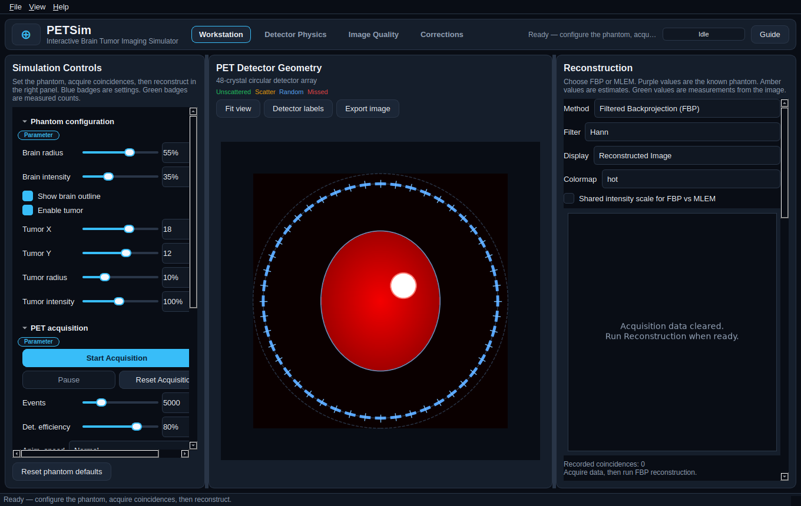
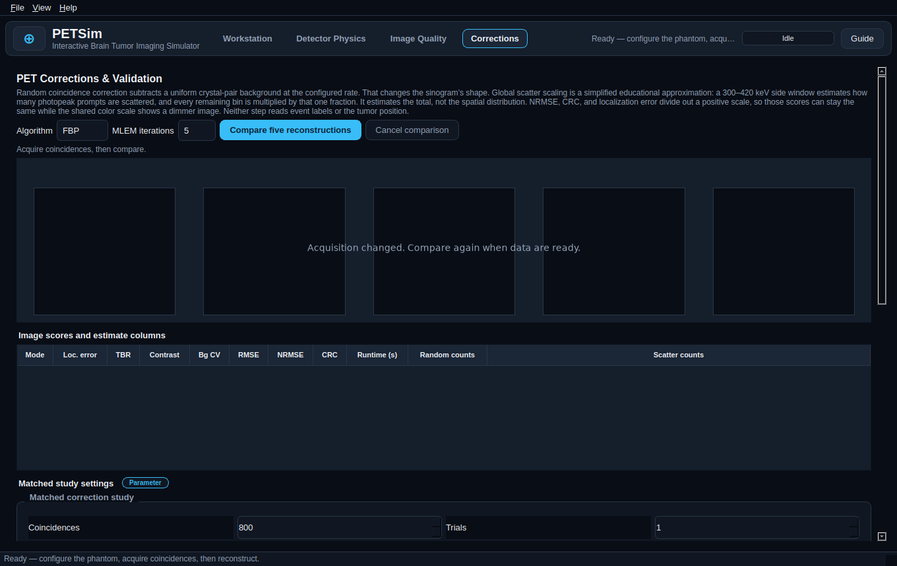

# PETSim — Interactive Brain Tumor Imaging Simulator

Educational desktop workstation for **computational simulation of brain-tumor PET imaging**.  
Built with **Python 3.11+**, **PySide6**, **NumPy**, and embedded **Matplotlib**.

> **Not a clinical diagnostic tool.** Stage 4 metrics are educational reconstruction-quality measures, not calibrated clinical PET quantities (SUV, Bq/mL, or validated detectability indices).

---

## Stages

| Stage | Status | Contents |
| --- | --- | --- |
| **1** | Done | Dark three-panel UI, adjustable brain/tumor phantom, 48-crystal ring |
| **2** | Done | Annihilation sampling, 511 keV back-to-back photons, efficiency, coincidences, LOR animation |
| **3** | Done | Measured sinogram from coincidences + filtered backprojection (FBP) |
| **4** | Done | Tumor localization, TBR / contrast / background CV, coincidence-count comparison |
| **5** | Done | MLEM iterative reconstruction, convergence, and FBP comparison |
| **6** | Done | Repeated image-quality experiments versus coincidence count |
| **7** | Done | Energy resolution, timing window, randoms, and simplified Compton scatter |
| **8** | Done | Random coincidence correction and educational global scatter scaling |
| **9** | Done | Workstation layout, shared dark theme, and kind badges |
| **10** | Done | Single header navigation, metric cards, and a shared plot theme |
| **11** | **This release (v0.11.0)** | 511 keV attenuation and parallel-beam correction |

---

## Overview

PETSim is an educational desktop workstation for simulating brain-tumor PET imaging. It samples positron annihilations, flies 511 keV photon pairs to a circular detector, optionally applies a simplified detector model, and reconstructs the activity with filtered backprojection or MLEM. Quantitative scores compare the image with the known phantom. Nothing in the program is clinically validated, and the scores are not SUV or Bq/mL.

The window has one header. It holds the section navigation, a short status line, a progress indicator, and a Guide button. The four sections are Workstation, Detector Physics, Image Quality, and Corrections. Badges mark parameters, measurements, estimates, and ground truth.

## Features

* Adjustable brain and tumor phantom, with a 48-crystal ring by default.
* Animated acquisition of true, scattered, and random coincidences.
* FBP (ramp or Hann) and MLEM, with a convergence plot.
* Localization error, tumor-to-background ratio, contrast, background variability, and scale-normalized RMSE.
* Optional energy resolution, timing window, random insertion, and a single-scatter cartoon.
* Repeated image-quality trials versus coincidence count.
* Random-coincidence subtraction and a global scatter-count scale. The scatter step is not a spatial correction.

## Screenshots

These captures are from the Qt offscreen build used during development. They are not macOS screenshots. A Mac capture after an acquisition and an FBP reconstruction is still worth adding.





## Stage 11 overview

Stage 11 adds optional narrow-beam attenuation at 511 keV. It does not replace the Stage 10 workstation.

### Physical model

Field-of-view coordinates are unchanged. A scale, 10 cm per unit radius by default, converts path length to centimeters. Soft tissue uses μ = 0.096 cm⁻¹. Both values are editable.

μ is constant inside the elliptical brain silhouette and zero outside it. The tumor does not change μ. The ellipse is the transmission map a scanner would obtain from a CT or a transmission scan. The correction never reads tumor coordinates, event truth labels, or the activity image.

A photon that travels a tissue distance L (cm) is kept with probability

\[
e^{-\mu L}.
\]

The two photons are tested separately. For a straight line, the sum of the two tissue paths is the chord of that line of response. A photon that fails the test is not detected, so the measured coincidence list changes.

### Reconstruction

Each parallel-beam bin \((θ, s)\), the same coordinates as the sinogram and the projector, gets the chord through its bin center. The survival weight is \(a = \mathrm{clip}(e^{-\mu L}, 10^{-3}, 1)\).

Filtered backprojection multiplies the measured bin by \(1/a\), then uses the existing smooth and ramp. Bins that recorded zero stay zero. This raises the expected value of the surviving counts and also raises their variance. It does not put the absorbed photons back. It is a simplified parallel-beam weight, not a clinical PET attenuation correction.

MLEM keeps the measured counts. The forward projection is multiplied by \(a\), and the sensitivity image is the backprojection of \(a\). The same weight is not also applied to the counts. With attenuation off, \(a = 1\) and both algorithms match the previous reconstruction.

### Run a comparison

Open **Attenuation** in the simulation controls, turn on tissue attenuation, and choose **Compare attenuation**. The reconstruction view shows the μ map, an ideal reconstruction, the attenuated reconstruction, and the corrected reconstruction from the same emissions. The status line reports the change in tumor-mean recovery and the change in background coefficient of variation. Recovery is quantitative accuracy. The coefficient of variation is noise.

### Limitations

The head is a uniform ellipse, not a CT. μ does not change in bone, air, or the tumor. The sinogram weight is the chord through the parallel-beam bin center, not a crystal-pair system matrix. The survival floor is 10⁻³, so the longest chords are not amplified without limit. Filtered backprojection smooths the sinogram after the 1/a weight, which mixes neighboring attenuation factors. Random coincidences inserted at the detector have no tissue path. There is no time-of-flight reconstruction.

Stage 10 region and localization functions are unchanged. The activity raster and the attenuation map use the ellipse `(x / 0.85)² + y² ≤ brain_radius²`. The background ROI and the localization search use the circle `x² + y² ≤ brain_radius²`. On a 128×128 grid that circle has 3,844 pixels and the ellipse has 3,260. The extra 584 pixels have zero activity and zero μ. The ellipse does not extend outside the circle.

The background score is a local annulus around the tumor, clipped to that circle. For the default tumor at (0.18, 0.12), 1 of 637 annulus pixels lies outside the ellipse, and the phantom contrast changes from 2.554 to 2.548 if that pixel is removed. NRMSE already uses the elliptical activity raster. A tumor moved to x = 0.35 puts about 25% of the same annulus outside the ellipse. Those positions need the ellipse intersection as an optional Stage 11 score. They do not change the Stage 10 default.

Scale-normalized NRMSE removes one global intensity factor, so it does not measure the photons that were absorbed. CRC divides reconstructed contrast by the phantom contrast on the same ROIs. The unattenuated reconstruction itself has CRC near 0.73–0.77 under the protocol below, so a corrected CRC near that range is agreement with the ideal reconstruction, not recovery of the phantom.

Localization uses the existing brightest-pixel search inside the circular brain. The known tumor position is used only to compute the distance after the estimate exists. The `reliable` flag means a positive peak was found. It does not mean the peak is the tumor. Every seed is reported. The mean and the median both include the large errors. One dominant noise peak inside the ellipse can be far from the tumor while a second peak is only moderately bright, so a rival-peak ratio is not used to drop seeds.

### Quantitative validation

Protocol: default phantom, μ = 0.096 cm⁻¹, 10 cm per field-of-view radius, survival floor 10⁻³, detector physics off, efficiency 1, 5,000 annihilations, seeds 1–5. Each seed is simulated twice so the attenuated detections are a subset of the same emissions. Reconstruction uses the defaults: 128×128, 96×128 sinogram, Hann filter, FBP pre-smooth σs = 1.5 and σθ = 0.75, 10 MLEM iterations. About 2,125–2,207 coincidences survive. Scores use the existing NRMSE, TBR, CRC, localization error, and background CV. Phantom contrast on these ROIs is 2.554.

| Method | Condition | NRMSE | TBR | CRC | Background CV |
| --- | --- | --- | --- | --- | --- |
| FBP | Ideal | 0.547 ± 0.008 | 2.97 ± 0.12 | 0.773 ± 0.048 | 0.601 ± 0.037 |
| FBP | Attenuated | 0.695 ± 0.014 | 2.84 ± 0.30 | 0.721 ± 0.119 | 0.792 ± 0.037 |
| FBP | Corrected | 0.660 ± 0.018 | 2.99 ± 0.37 | 0.781 ± 0.144 | 0.772 ± 0.026 |
| MLEM | Ideal | 0.631 ± 0.007 | 2.87 ± 0.08 | 0.733 ± 0.032 | 0.815 ± 0.033 |
| MLEM | Attenuated | 0.806 ± 0.006 | 2.78 ± 0.24 | 0.698 ± 0.094 | 1.226 ± 0.074 |
| MLEM | Corrected | 0.781 ± 0.004 | 2.95 ± 0.29 | 0.763 ± 0.115 | 1.187 ± 0.052 |

The spread is the standard deviation across the five seeds with divisor 5. NRMSE improved on every seed relative to the attenuated image, and CRC moved closer to 1 on every seed. Corrected NRMSE stays above the ideal reconstruction. Background CV stays above the ideal image on every seed. These are measured results for this protocol.

Localization error is in field-of-view units. All five seeds are listed. No seed is removed.

| Seed | FBP ideal | FBP attenuated | FBP corrected | MLEM ideal | MLEM attenuated | MLEM corrected |
| --- | --- | --- | --- | --- | --- | --- |
| 1 | 0.033 | 0.047 | 0.035 | 0.015 | 0.399 | 0.021 |
| 2 | 0.028 | 0.038 | 0.017 | 0.008 | 0.050 | 0.016 |
| 3 | 0.020 | 0.014 | 0.002 | 0.571 | 0.657 | 0.016 |
| 4 | 0.018 | 0.011 | 0.003 | 0.113 | 0.156 | 0.015 |
| 5 | 0.010 | 0.021 | 0.006 | 0.015 | 0.009 | 0.009 |
| Mean | 0.022 | 0.026 | 0.013 | 0.144 | 0.254 | 0.015 |
| Median | 0.020 | 0.021 | 0.006 | 0.015 | 0.156 | 0.016 |

The MLEM mean is carried by seeds 3 and 1. The ideal MLEM median is 0.015. All 30 estimates were produced, and all 30 fell inside the ellipse. With attenuation disabled, or with μ = 0, the events and the FBP and MLEM images match the Stage 10.2 path. Applying the attenuation weight a second time changes both images. The weighted forward and adjoint operators agree to about 10⁻¹⁴ on a random test image.

## Stage 10 overview

Navigation is only the header. The old second row of tabs is gone. Simulation settings sit in collapsible groups, and each slider has a numeric field with the same range. Live annihilations and coincidences are metric cards. The detector panel names the crystal count from the ring model, keeps the event colors, and can fit or export the view. Plots share one dark axis style. Tables right-align numbers. Scatter scaling is still described as one fraction on the prompt sinogram.

## Stage 9 overview

The window is one dark workstation theme. A step bar and numbered tabs follow the same order: Workstation, Detector Physics, Image Quality, Corrections. The workstation gives extra width to the detector view and the reconstruction. Controls stay in a scrolling column.

Colored badges mark four kinds of information:

* **Parameter** — a setting that changes the next run
* **Measured** — a count or score from the acquisition or the image
* **Estimated** — a model quantity, including the random-count subtraction and the global scatter scale
* **Ground truth** — a phantom value used only after reconstruction

Global scatter scaling is still one fraction on the prompt sinogram. The corrections tab does not present it as a spatial scatter correction. Long tasks show a progress bar and a cancel button. The scientific calculations are unchanged.

## Stage 8 overview

The **PET Corrections & Validation** tab compares five reconstructions of one acquisition: ideal, uncorrected, random coincidence correction, global scatter scaling, and both. FBP and MLEM receive the same corrected prompt sinogram for a given mode. Prompts are clipped at zero before either algorithm. The uncorrected image stays in the comparison.

### Random coincidence correction

Random correction subtracts

\[
\mu_R = \rho N_{\text{annihilations}}
\]

spread over every unordered crystal pair. \(\rho\) is the random probability the acquisition was configured with. The estimator does not look at which events were random. If detector effects were off, \(\rho\) is treated as zero. Because the background is uniform in crystal pairs and the brain is not, this subtraction changes the sinogram’s shape. The table’s **Random counts** column is \(\mu_R\).

Assumptions: the configured \(\rho\) is the insertion probability, pairs are uniform, every random is accepted, and crystals are equally efficient. This is not a delayed-coincidence measurement.

### Global scatter scaling

Scatter handling is a simplified educational approximation of the **total** photopeak scatter count. It is not a spatial scatter correction.

A witness coincidence has one photon in 300–420 keV and the other inside the acquisition photopeak (default 435–650 keV). Random records are stored at 511 keV, so they are not witnesses. A phantom-free Monte Carlo of the Stage 7 Compton deflection and energy resolution gives a transfer factor \(k\) from the configured scatter probability. The estimated photopeak scatter count is \(T = k N_w\). After random subtraction, every nonnegative bin of the residual is multiplied by the same fraction \(\min(T / \sum R, 1)\). The table’s **Scatter counts** column is that removed total.

The side-window lines are not subtracted as a map. They are broader than the small-angle scatter the photopeak still accepts. A mixture of the side-window sinogram and the prompt sinogram does not fit the true photopeak-scatter distribution better than the prompts alone, so those measurements do not support a spatial template. If the acquisition window already starts below about 425 keV, there is no side window left under it and the estimate is zero.

### Why some scores do not move

RMSE is computed after a nonnegative least-squares scale \(\alpha\) that aligns the clipped reconstruction with the phantom raster. NRMSE divides that RMSE by the RMS of the activity map. CRC is measured contrast divided by the contrast of the same ROIs on the phantom raster. Localization uses the peak inside the search window. A positive global scale divides out of NRMSE, CRC, contrast, background CV, and localization error. On the shared color scale the scatter-scaled image is dimmer because counts were removed. That is the limit of these measurements. None of the scores are calibrated SUV or Bq/mL errors, and a step is not claimed to improve every score.

### Validation

Labels and tumor coordinates are used only after reconstruction, in the metrics and in tests. The estimators do not read them.

Checked behavior:

* With scatter and no randoms, the scatter count follows the labeled photopeak-scatter count (within 30% in the automated cases) and the random count stays zero.
* With randoms and no scatter, the side-window count stays near zero, so scatter scaling does not copy the random estimate.
* Scatter scaling leaves the prompt sinogram proportional to the input. FBP and MLEM receive that same sinogram. Scale-free scores stay with the uncorrected image.
* Random correction changes bin ratios. FBP and MLEM receive the same corrected sinogram for each mode.
* The true photopeak-scatter sinogram stays closer to the prompts than to the side-window sinogram. Subtracting the side-window shape was tried and rejected because it cuts into the brain.

The matched study simulates each prompt list once, then reconstructs every selected mode from that list. The original Image Quality Experiments tab is unchanged.

Stage 7 timing acceptance is still only an accept/reject cut. There is no time-of-flight reconstruction, attenuation correction, or delayed-window random measurement.

---

## Stage 7 overview

The **Detector Physics** tab adds optional detector degradation. **Enable detector effects** is off by default, so Stages 1–6 keep the ideal coincidence model (`P(coincidence) = ε²`). An acquisition keeps the detector settings it started with. Later slider changes apply to the next acquisition and do not rewrite events already stored.

The tab has its own energy histogram, accepted-class bar chart, and ideal-versus-degraded image pair. Those figures are not the workstation reconstruction canvas, the MLEM convergence graph, the Stage 4 count-comparison graph, or the Stage 6 experiment plots.

### Units and scale

| Quantity | Unit | Definition |
| --- | --- | --- |
| Photon energy | keV | 511 keV before detector blur or Compton loss |
| Energy resolution | percent | FWHM at 511 keV |
| Time | ps | picoseconds |
| Ring scale | cm | normalized radius 0.92 represents 15 cm |
| Speed of light | cm/ps | 0.0299792458 |

### Energy

\[
\mathrm{FWHM}_E = 511\,\mathrm{keV}\times\frac{\mathrm{percent}}{100},
\quad
\sigma_E = \frac{\mathrm{FWHM}_E}{2\sqrt{2\ln 2}}
\]

Measured energy is Gaussian about the true photon energy and clipped at 0 keV. Both photons must lie in \([E_\mathrm{low}, E_\mathrm{high}]\). The histogram draws those two bounds.

### Timing

Path length is converted from FOV units to centimetres with the 15 cm ring scale, then divided by \(c\).

\[
\Delta t_\mathrm{flight} = t_A - t_B
\]

\[
\Delta t_\mathrm{residual} \sim \mathcal{N}(0, \sigma_\mathrm{CTR}^2),
\quad
\sigma_\mathrm{CTR} = \frac{\mathrm{FWHM}_\mathrm{CTR}}{2\sqrt{2\ln 2}}
\]

\[
\Delta t_\mathrm{measured} = \Delta t_\mathrm{flight} + \Delta t_\mathrm{residual}
\]

\(\mathrm{FWHM}_\mathrm{CTR}\) is the full width of the detector contribution to the **time difference**, not the width of one crystal. Geometric correction means subtracting the true flight time:

\[
\Delta t_\mathrm{residual} = \Delta t_\mathrm{measured} - \Delta t_\mathrm{flight}
\]

That subtraction uses the simulated path lengths. A coincidence processor does not know the annihilation point, so it cannot do it. **The acceptance window is applied to \(|\Delta t_\mathrm{measured}|\)**, not to the flight time and not to the residual. Timing is an accept/reject cut only. There is no time-of-flight reconstruction.

### Random coincidences

`random fraction` is the probability that one annihilation also adds one accepted coincidence between two distinct, uniformly chosen crystals. The endpoints are crystal centers. They are not a back-to-back line from the tumor or from that annihilation.

### Compton scatter

Each photon scatters at most once, with the chosen probability. The site is 20–80% of the way along the original chord. The in-plane deflection \(\phi\) is Gaussian (default standard deviation 0.6 rad). Energy follows

\[
E' = \frac{E}{1 + (E/511\,\mathrm{keV})(1-\cos\phi)}
\]

and then the energy resolution and energy window. This is not Klein–Nishina sampling, not attenuation, and not a validated patient-scatter simulation.

### Event accounting

These bins do not overlap:

* generated annihilations
* detected singles (exactly one photon passed the efficiency draw)
* undetected (neither photon passed efficiency)
* accepted unscattered coincidences
* accepted scattered coincidences
* energy-window rejections
* timing-window rejections

Every annihilation is in exactly one of those bins. A pair that fails the energy window is an energy rejection even if its measured time difference is also outside the timing window. Random coincidences are extra accepted events, not annihilations.

\[
N_\mathrm{accepted} = N_\mathrm{true} + N_\mathrm{scattered} + N_\mathrm{random}
\]

Workstation **Reconstruct** and both FBP and MLEM receive only accepted ring hits: true, scattered, and random. They do not receive tumor coordinates. The ideal-versus-degraded view reconstructs efficiency-detected pre-scatter hits beside those accepted hits, with the same algorithm.

### Experiments

On **Image Quality Experiments**, **Apply Detector Physics tab settings** is unchecked by default. The experiment then ignores the physics tab and keeps the ideal model.

If you check it, the tab’s settings are copied at start and written into the CSV metadata (`detector_effects_applied` and each parameter). The coincidence target then counts accepted events, including scatter and randoms. FBP and MLEM in one trial still share that list.

---

## Stage 6 overview

The **Image Quality Experiments** tab runs repeated acquisitions and reconstructions without using the tumor location as a reconstruction input.

For each selected detected-coincidence target (default 1,000, 3,000, 5,000, 10,000, and 20,000) and each independent trial:

1. Annihilations are simulated with the current phantom until that many coincidences are recorded.
2. Exactly that prefix is reconstructed with FBP, MLEM, or both. A shared trial seed means both methods see the same coincidences.
3. Stage 4 metrics are stored: localization error (FOV), tumor-to-background ratio, relative contrast, background coefficient of variation, runtime, and MLEM iteration count.

The table and plots report the **mean and sample standard deviation across trials**. That spread is acquisition variability inside this simulator. It is not the MLEM convergence curve and it is not a clinical error bar. FBP still may pre-smooth the sinogram; MLEM uses unsmoothed counts. Neither method is assumed to win every metric.

### Run an experiment

1. Set the phantom on the Workstation tab.  
2. Open **Image Quality Experiments**.  
3. Choose methods, count levels, trials, seed, MLEM iterations, FBP filter, and detector efficiency.  
4. Click **Start Experiment**. Cancel stops between steps and keeps finished trials. **Reset Results** clears the table and plots.  
5. **Export CSV and PNG** writes `trials.csv`, `aggregates.csv`, and one PNG per plot. Comment lines in the CSV files record the seed, phantom, counts, filter, iterations, and the FBP/MLEM preprocessing difference.

Example: seed `1`, both methods, 3 trials, counts 1,000 and 3,000, Hann filter, 10 MLEM iterations. Compare the error bars before treating a single run as typical.

---

## Stage 5 overview

Stage 5 adds **maximum-likelihood expectation maximization (MLEM)** next to filtered backprojection. Both algorithms consume the same measured coincidence list. MLEM does not use the tumor’s true position.

### FBP versus MLEM

FBP filters each projection with a ramp (optionally Hann-windowed) and backprojects once. It is fast and linear, and it can produce negative pixels. With few coincidences the ramp amplifies noise, which is why the FBP path still applies a light sinogram smooth.

MLEM iteratively updates a nonnegative image so that its predicted sinogram better matches the measured counts under a Poisson model:

\[
x^{k+1}_j = \frac{x^k_j}{\sum_i A_{ij}} \sum_i \frac{A_{ij}\, y_i}{\sum_l A_{il} x^k_l}
\]

`A` is a pixel-driven parallel-beam projector (linear interpolation in `s`) and `Aᵀ` is the matching backprojector. They are adjoints; neither is the FBP operator. Sensitivity `Σ_i A_ij` normalizes the update. Zero-sensitivity pixels stay at 0. Bins with predicted counts of 0 contribute nothing to the ratio; if those bins also contain counts, the Poisson log-likelihood is undefined.

The tracked objective is

\[
L(x) = \sum_i \big(y_i \log \hat y_i - \hat y_i\big)
\]

with `ŷ = Ax` when attenuation is off. With the Stage 11 weight on, `ŷ = a ⊙ (Ax)` and the sensitivity is the backprojection of `a`. The constant `Σ log(y!)` is omitted either way. Relative change is `‖xⁿ − xⁿ⁻¹‖ / ‖xⁿ⁻¹‖`. More iterations usually raise `L` and can look smoother, but they are not guaranteed to improve localization error, contrast, or background CV on one noisy realization. Early iterates are blurry; later iterates fit noise. Scatter and randoms are not inside this projector.

### Using Stage 5

1. Acquire coincidences as in Stages 2–3.  
2. In **Method**, choose **Filtered Backprojection (FBP)** or **Maximum Likelihood EM (MLEM)**.  
3. FBP still uses **Filter** (Hann or Ramp). MLEM shows **Iterations** (1, 5, 10, 20, 50; default 10) and hides the FBP filter.  
4. **Run Reconstruction** updates the PET image canvas only. MLEM also fills the separate convergence canvas and can be cancelled between iterations.  
5. **Compare FBP and MLEM** reconstructs both from the same coincidences and switches the image view to **FBP vs MLEM**.  
6. **Shared intensity scale** forces one display maximum for that pair. Independent scaling is the default. Metrics always use nonnegative reconstructed values, not the display scale.  
7. The FBP-versus-MLEM table reports localization error (FOV), TBR, relative contrast, background CV, runtime, and the MLEM iteration count.  
8. The Stage 4 count-comparison graph stays on its own canvas. That comparison still uses FBP.

### Reproduce a comparison

Use a fixed acquisition seed, the same event count and detector efficiency, then **Compare FBP and MLEM** at 10 iterations with the Hann FBP filter. Repeat with 1 and 50 iterations to see the likelihood rise without assuming every metric improves.

---

## Stage 4 overview

After Stage 3 reconstruction, PETSim can quantitatively evaluate the reconstructed image against the phantom settings that generated the acquisition:

1. **Tumor localization accuracy** — estimate the tumor center from the reconstructed image and compare it with the known phantom center.  
2. **Tumor-to-background contrast** — ROI means, TBR, relative contrast, and background coefficient of variation.  
3. **Image quality vs coincidence count** — rebuild nested prefixes of the same coincidence list at 1k / 3k / 5k / 10k detected coincidences and tabulate metrics.

Workflow:

1. Enable a tumor and set a known center.  
2. Run an acquisition (prefer enough events to reach several thousand coincidences).  
3. **Run Reconstruction**.  
4. In **Quantitative Analysis**, click **Run Analysis**.  
5. Optionally click **Count Comparison**. The CV graph appears in its own section and leaves the reconstructed image in place.  
6. Resetting acquisition, clearing reconstruction, changing the phantom, or changing the FBP filter clears stale metrics.

### Tumor localization

Method: **constrained intensity-weighted centroid** on nonnegative reconstructed intensities.

1. Restrict the search to the circular brain disk (phantom *radius* only — not the tumor center).  
2. Find the brightest pixel in that region (coarse peak).  
3. Compute an intensity-weighted centroid in a local neighborhood around the peak.  
4. Convert the centroid to FOV coordinates using the same pixel-center grid as FBP (`linspace(-fov, fov, N)`, row↔y, col↔x).

Localization error:

\[
\sqrt{(x_\mathrm{est}-x_\mathrm{true})^2 + (y_\mathrm{est}-y_\mathrm{true})^2}
\]

reported in FOV units. The estimate comes from reconstructed image data only; ground-truth coordinates are used for error evaluation (and ROI placement below), never to invent the estimate. If the tumor is disabled or the search region has no positive intensity, the GUI shows an explanatory message instead of a fabricated measurement.

### Tumor / background ROIs and contrast

Intensity basis (documented and consistent): **nonnegative display-clipped** reconstructed values `max(image, 0)`. Raw FBP negatives are excluded so background means are not artificially lowered. These are relative reconstruction units — **not** clinical activity concentrations.

* **Tumor ROI**: circle at the documented ground-truth tumor center with radius `tumor_radius`.  
* **Background ROI**: annulus around the same center with inner radius `1.5 × tumor_radius` and width `0.12` FOV units, clipped to the brain disk and excluding tumor pixels.

Metrics:

* \(\mathrm{TBR} = \mu_\mathrm{tumor} / \mu_\mathrm{background}\)  
* \(\mathrm{Contrast} = (\mu_\mathrm{tumor} - \mu_\mathrm{background}) / \mu_\mathrm{background}\)  
* \(\mathrm{Background\ CV} = \sigma_\mathrm{background} / \mu_\mathrm{background}\)

Background CV is a variability measure; it is **not** automatically labeled tumor SNR. Zero / negative / NaN background means yield invalid ratios with a clear message. Tiny or empty ROIs are flagged.

### Coincidence-count comparison

Target levels are **detected coincidence counts**: 1000, 3000, 5000, 10000.

PETSim takes nested prefixes of the current measured coincidence list (the first N events), rebuilds the sinogram, runs FBP with the same settings, and recomputes localization error, TBR, and background CV. Levels above the available coincidence total are marked unavailable — events are never fabricated. Individual random realizations need not improve monotonically.

---

## Stage 3 overview (still included)

Workflow:

1. Adjust brain / tumor parameters.  
2. Run a Stage 2 acquisition (Start Acquisition).  
3. Click **Run Reconstruction**.  
4. PETSim bins measured LORs into a sinogram \(p(\theta, s)\).  
5. PETSim applies **filtered backprojection** to form a \(128\times 128\) activity image.  
6. View **Reconstructed Image**, **Sinogram**, or **Comparison**. The coincidence-count graph uses its own canvas below the metrics and does not replace the PET image.

Reconstruction uses **only coincidence endpoints** (detector-ring hits). True annihilation positions are never reconstruction inputs.

### Sinogram

Each accepted coincidence defines a line of response (LOR). In normal form:

\[
x\cos\theta + y\sin\theta = s
\]

- \(\theta \in [0,\pi)\): angle of the LOR normal  
- \(s\): signed perpendicular distance from the scanner center  

Default educational grid: **96 angular × 128 radial** bins (ring radius \(s_{\max}=0.92\)), with mild Gaussian pre-smoothing before FBP.

### Filtered backprojection (FBP)

Default Hann-windowed ramp filter; negatives from ringing are kept in the raw array and clipped only for display (percentile windowing ≈99.5%).

### Model assumptions (still idealized)

- Ideal back-to-back emission and 2-D geometry. Attenuation is optional and off by default.
- No scatter or randoms in the geometric projector, no positron range, and no time-of-flight reconstruction
- 48 crystals → limited distinct LORs → angular sampling artifacts are expected  

---

## Project layout

```
petsim/
├── acquisition_controller.py
├── reconstruction_worker.py      # QThread FBP worker
├── analysis_worker.py            # QThread Stage 4 analysis worker
├── experiment_worker.py          # QThread Stage 6 experiments
├── experiments/                  # Acquisition repeats, metrics, CSV export
├── models/                       # Phantom + detector geometry
├── physics/                      # Stage 2 acquisition engine
├── reconstruction/               # Stage 3 FBP + Stage 5 MLEM (Qt-free)
│   ├── lor.py
│   ├── sinogram.py
│   ├── fbp.py
│   ├── projectors.py             # Adjoint forward / back projectors
│   ├── mlem.py
│   └── pipeline.py
├── analysis/                     # Stage 4 (Qt-free)
│   ├── coordinates.py            # Pixel ↔ FOV
│   ├── localization.py           # Constrained centroid
│   ├── roi.py                    # TBR / contrast / CV
│   ├── count_comparison.py       # Nested count levels
│   └── pipeline.py               # analyze_reconstruction
└── widgets/                      # Controls, detector view, recon panel
tests/
```

---

## Setup

```bash
git clone <repo-url> PETSim-Interactive-Brain-Tumor-Imaging-Simulator
cd PETSim-Interactive-Brain-Tumor-Imaging-Simulator

python3 -m venv .venv
source .venv/bin/activate

pip install -r requirements.txt
pip install -e ".[dev]"            # pytest
```

---

## Run the application

```bash
python -m petsim
# or
./.venv/bin/python -m petsim
```

### Acquisition + reconstruction + analysis

1. Set tumor / brain parameters (enable tumor; note the true center).  
2. Choose event count, detector efficiency, optional seed; click **Start Acquisition**.  
3. Wait until acquisition completes (or pause — reconstruction uses recorded coincidences so far).  
4. In the right panel: choose Filter (**Ramp** / **Hann**), Display mode, colormap.  
5. Click **Run Reconstruction**.  
6. Click **Run Analysis** — inspect localization, TBR, contrast, and background CV.  
7. Optionally enable **Overlay tumor / background ROIs**.  
8. Click **Count Comparison** for the 1k–10k table and the separate CV plot.  
9. Changing the phantom **clears** acquisition, reconstruction, and analysis so datasets are never mixed.

---

## Tests

```bash
pip install -e ".[dev]"

# Linux / CI (headless):
QT_QPA_PLATFORM=offscreen python -m pytest -q

# Project interpreter:
./.venv/bin/python -m pytest -q

# macOS (use cocoa — matches a working PETSim GUI):
QT_QPA_PLATFORM=cocoa python -m pytest -q
```

**macOS note:** ``offscreen`` and ``minimal`` are often broken with PySide6 even when
plugin files exist on disk (abort / exit 134), while **``cocoa`` works** and is what
the desktop app uses. ``tests/conftest.py`` therefore defaults Darwin to ``cocoa`` and
remaps ``offscreen``/``minimal`` → ``cocoa`` (an explicit ``cocoa`` choice is preserved).
``MainWindow`` checks still run in a subprocess so a plugin abort cannot kill parent pytest.

Coverage includes LOR \(\leftrightarrow (\theta,s)\) conversion, sinogram binning, FBP,
pixel↔FOV coordinates, synthetic-blob localization, ROI / TBR / CV edge cases,
coincidence-count comparison, analysis invalidation, and Stage 2–3 regression tests.

---

## Known limitations

- Educational model only — not clinically accurate or validated for patient imaging  
- Coarse 48-detector geometry + finite counts → residual streaks and localization scatter  
- Attenuation is a uniform ellipse and a parallel-beam bin weight, not a clinical correction
- Stage 10 ROI and localization code still use the circular brain. The attenuation map uses the taller ellipse. See the Stage 11 limitations for the pixel counts.
- Localization error is reported for every seed, with the mean and the median. Large errors stay in both summaries.  
- Count-comparison curves are single-realization nested prefixes — not ensemble averages  
- Very low counts remain noisy; prefer ≥5k coincidences for stable demos  
- MLEM uses an unsmoothed sinogram; FBP may pre-smooth. Same coincidences, different preprocessing  
- Extra MLEM iterations can fit noise; they do not guarantee better localization or contrast  
- Default MLEM is 10 iterations on a 128×128 grid with the 96×128 sinogram  
- Experiment error bars are across independent simulated acquisitions in this simplified model  
- Large count levels with several MLEM trials take longer; cancel leaves completed trials in the table  

---

## License

MIT (see `pyproject.toml`).
