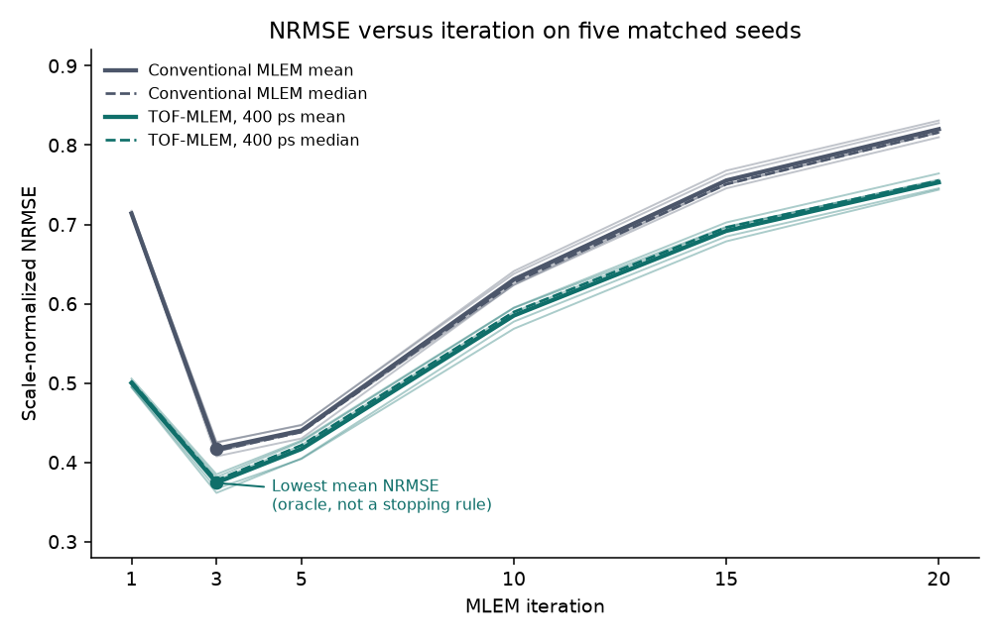

# Stage 12 validation

This note records one matched-seed check of TOF-MLEM. It does not change the projector, the acquisition, or the user interface. Demonstrated numbers are labeled as such. Statements about what a narrower clock ought to do are labeled as theory.

## What was held fixed

Both reconstructions consumed one acquisition per seed. The acquisition drew 5000 annihilations from the default phantom, with detector efficiency 1, detector physics off, and attenuation off. The ring has 48 crystals. Seeds were 1, 2, 3, 4, and 5. Random coincidences were not generated. Both algorithms therefore saw the same 5000 true endpoints. Conventional MLEM ignored the arrival times. TOF-MLEM used them.

The image is 128×128. The sinogram is 96 angles by 128 radial bins. TOF uses 21 time bins on [−1.45, 1.45] and 10 cm per field-of-view radius. The reported iteration count is 20 unless a row says 10. MLEM is unsmoothed. Scores use the existing tools: scale-normalized NRMSE, contrast recovery (measured contrast divided by the phantom contrast on the Stage 10 disk ROIs), background coefficient of variation, and localization error in field-of-view units. The tumor center is used only after the image exists. Means use every seed. The standard deviation uses divisor 5, matching the Stage 11 tables. No seed was dropped.

## Timing follows `c σ_t / 2`

Theory: the residual of `Δt = t_A − t_B` is Gaussian with `σ_t = FWHM / (2 √(2 ln 2))`, and the along-line miss of the most likely point has `σ_x = c σ_t / 2`. At 10 cm per field-of-view radius that is 0.12731, 0.25462, and 0.38193 field-of-view units at 200, 400, and 600 ps.

Demonstrated, pooled over the five seeds (25,000 true pairs). The signed along-line error was evaluated against the true annihilation only for this check. Reconstruction never received that coordinate.

| FWHM | `σ_t` (ps) | Residual sample std (ps) | Signed spatial std | `σ_x` | Ratio |
| --- | ---: | ---: | ---: | ---: | ---: |
| 200 ps | 84.93 | 85.02 | 0.12743 | 0.12731 | 1.001 |
| 400 ps | 169.86 | 170.03 | 0.25487 | 0.25462 | 1.001 |
| 600 ps | 254.80 | 255.05 | 0.38230 | 0.38193 | 1.001 |

The three spatial standard deviations are in the ratio 1 : 2 : 3 because the three acquisitions share one standard-normal draw and scale it by the timing width. A nonzero sample mean of about 0.0014 field-of-view units at 200 ps, doubling and tripling at 400 and 600 ps, is that same finite-sample mean. It is small next to `σ_x / √25000`.

The standard deviation of the unsigned distance is about 0.603 times `σ_x`. That is `√(1 − 2/π)` for a half-normal, not a missing factor of `c/2`.

## Forward model, adjoint, and sensitivity

On a random 14×14 image, 10 angles, 14 radial bins, 15 time bins, and a flat survival of 0.4, `Σ (Hx) y` and `Σ x (Hᵀ y)` differed by 0. Sensitivity equalled the backprojection of an array of ones, including the empty time bins.

A noiseless disk whose data were `y = Hx` (no attenuation) reached an interior mean of 0.987 after 20 iterations. The exterior mean was 0.00048. Replacing the sensitivity by the backprojection of only the occupied bins left an exterior mean of 0.012. Pre-dividing those counts by a survival of 0.35 and then also passing that survival into TOF-MLEM changed the image by a maximum absolute difference of 2.10. The single-application interior mean was 0.972. The production call applies the survival once.

`tof_mlem_reconstruct` has no tumor argument. The TOF projector and the pipeline do not read a tumor coordinate.

## Disabling TOF matches Stage 11

Two batches from seed 11 (80 events, then 40, efficiency 0.75) were run in the Stage 11 tree at `ed6a117` and in this tree with TOF omitted and with TOF explicitly disabled. Origins, angles, hits, detection flags, the FBP image, and a 4-iteration MLEM image were identical, maximum absolute difference 0. Disabled TOF stored `Δt = 0` and drew no timing residual.

The 10-iteration conventional images in the study below also reproduce the published Stage 11 ideal MLEM summary: NRMSE mean 0.631, CRC mean 0.733, background CV mean 0.815, localization mean 0.144. The per-seed localization errors are 0.015, 0.008, 0.571, 0.113, and 0.015. Those images ignore arrival time, and one `simulate_batch` draws the timing residual after detection, so the coincidence list matches a Stage 11 run with the same seed.

The full suite on this tree was 149 passed and 1 skipped. The skip is the macOS Qt platform check.

## Five-seed reconstructions at 20 iterations

Conventional columns are the same at every FWHM. Only the TOF kernel changes. NRMSE is scale-normalized. Localization is in field-of-view units. CRC is contrast recovery. CV is the background coefficient of variation.

### 400 ps, the default clock

| Seed | NRMSE conv → TOF | Localization conv → TOF | CRC conv → TOF | CV conv → TOF |
| --- | ---: | ---: | ---: | ---: |
| 1 | 0.816 → 0.744 | 0.007 → 0.011 | 0.748 → 0.774 | 1.321 → 1.137 |
| 2 | 0.816 → 0.746 | 0.020 → 0.016 | 0.873 → 0.773 | 1.635 → 1.148 |
| 3 | 0.828 → 0.755 | 0.572 → 0.039 | 0.819 → 0.739 | 1.488 → 1.092 |
| 4 | 0.810 → 0.756 | 0.150 → 0.569 | 0.794 → 0.737 | 1.497 → 1.078 |
| 5 | 0.831 → 0.764 | 0.026 → 0.251 | 0.757 → 0.709 | 1.530 → 1.190 |
| Mean | 0.820 → 0.753 | 0.155 → 0.177 | 0.798 → 0.746 | 1.494 → 1.129 |
| Median | 0.816 → 0.755 | 0.026 → 0.039 | 0.794 → 0.739 | 1.497 → 1.137 |

### 200 ps and 600 ps, TOF only

Conventional values do not depend on FWHM. Measured TOF differences below are 200 minus 400 and 400 minus 600. A negative NRMSE difference means the sharper clock had the lower error on that seed.

| Seed | NRMSE 200 / 400 / 600 | Localization 200 / 400 / 600 | CRC 200 / 400 / 600 | CV 200 / 400 / 600 |
| --- | ---: | ---: | ---: | ---: |
| 1 | 0.736 / 0.744 / 0.746 | 0.014 / 0.011 / 0.011 | 0.771 / 0.774 / 0.762 | 1.157 / 1.137 / 1.125 |
| 2 | 0.737 / 0.746 / 0.750 | 0.015 / 0.016 / 0.014 | 0.743 / 0.773 / 0.794 | 1.103 / 1.148 / 1.187 |
| 3 | 0.746 / 0.755 / 0.759 | 0.045 / 0.039 / 0.029 | 0.700 / 0.739 / 0.784 | 1.097 / 1.092 / 1.094 |
| 4 | 0.742 / 0.756 / 0.760 | 0.032 / 0.569 / 0.564 | 0.729 / 0.737 / 0.759 | 1.110 / 1.078 / 1.064 |
| 5 | 0.757 / 0.764 / 0.767 | 0.270 / 0.251 / 0.281 | 0.686 / 0.709 / 0.737 | 1.205 / 1.190 / 1.207 |
| Mean | 0.743 / 0.753 / 0.756 | 0.075 / 0.177 / 0.180 | 0.726 / 0.746 / 0.767 | 1.134 / 1.129 / 1.135 |
| Median | 0.742 / 0.755 / 0.759 | 0.032 / 0.039 / 0.029 | 0.729 / 0.739 / 0.762 | 1.110 / 1.137 / 1.125 |

Measured TOF differences at 20 iterations:

| Quantity | 200 ps | 400 ps | 600 ps | 200 − 400 | 400 − 600 |
| --- | ---: | ---: | ---: | ---: | ---: |
| NRMSE mean | 0.743 | 0.753 | 0.756 | −0.010 | −0.003 |
| Localization mean | 0.075 | 0.177 | 0.180 | −0.102 | −0.003 |
| Localization median | 0.032 | 0.039 | 0.029 | −0.007 | +0.010 |
| CRC mean | 0.726 | 0.746 | 0.767 | −0.020 | −0.021 |
| Background CV mean | 1.134 | 1.129 | 1.135 | +0.005 | −0.006 |
| Signed spatial std | 0.12743 | 0.25487 | 0.38230 | −0.12744 | −0.12743 |

The spatial step is 0.1274 field-of-view units per 200 ps. Theory for `c σ_t / 2` is 0.12731 per 200 ps. Mean NRMSE falls by 0.003 from 600 ps to 400 ps and by 0.010 from 400 ps to 200 ps. Every seed has that same order. CRC moves about 0.02 closer to 1 for each wider clock, which is the opposite direction. Background CV changes by less than 0.01 across the three widths. The localization mean drops from 400 ps to 200 ps because seed 4 is 0.569 at 400 ps and 0.032 at 200 ps. The median barely moves. That mean difference is one peak, not a uniform localization gain.

## Iterations 1, 3, 5, 10, 15, and 20

The curves below use the same five acquisitions as the 400 ps column. Each point is a finished run of the existing MLEM update stopped at that iteration. Thin lines are the seeds. The solid line is the mean and the dashed line is the median. The marker is the iteration with the lowest mean NRMSE.

| Iteration | Conventional mean | Conventional median | TOF mean | TOF median |
| --- | ---: | ---: | ---: | ---: |
| 1 | 0.714 | 0.713 | 0.500 | 0.502 |
| 3 | 0.417 | 0.415 | 0.374 | 0.377 |
| 5 | 0.440 | 0.438 | 0.417 | 0.422 |
| 10 | 0.631 | 0.627 | 0.585 | 0.590 |
| 15 | 0.755 | 0.751 | 0.692 | 0.696 |
| 20 | 0.820 | 0.816 | 0.753 | 0.755 |

On this sample the lowest mean is iteration 3 for both methods: 0.417 conventional and 0.374 TOF. Every seed has its own lowest NRMSE at iteration 3 as well, so the mean is not being pulled by one acquisition. Calling iteration 3 best uses the phantom NRMSE. A reconstruction cannot see that score. It is an oracle diagnostic for this sample, not a stopping rule and not a claim about other phantoms or count levels.

TOF NRMSE is lower than conventional NRMSE at every listed iteration and on every seed. The mean gap is 0.214 at iteration 1, 0.043 at iteration 3, and 0.067 at iteration 20.

## Localization, with every seed kept

The estimator is still the brightest peak. Nothing in this review changes it or drops a seed. Errors are field-of-view units. The maximum is the worst seed, not a discarded outlier.

### At iteration 3, where mean NRMSE is lowest

| Seed | Conventional | TOF, 400 ps |
| --- | ---: | ---: |
| 1 | 0.032 | 0.026 |
| 2 | 0.014 | 0.035 |
| 3 | 0.068 | 0.021 |
| 4 | 0.023 | 0.018 |
| 5 | 0.017 | 0.016 |
| Mean | 0.031 | 0.023 |
| Median | 0.023 | 0.021 |
| Maximum | 0.068 | 0.035 |

### At iterations 5, 10, 15, and 20

| Iteration | Conventional errors | Mean / median / max | TOF errors | Mean / median / max |
| --- | --- | --- | --- | --- |
| 5 | 0.012, 0.010, 0.035, 0.010, 0.011 | 0.016 / 0.011 / 0.035 | 0.013, 0.009, 0.015, 0.008, 0.007 | 0.011 / 0.009 / 0.015 |
| 10 | 0.015, 0.008, 0.571, 0.113, 0.015 | 0.144 / 0.015 / 0.571 | 0.012, 0.007, 0.029, 0.573, 0.012 | 0.127 / 0.012 / 0.573 |
| 15 | 0.015, 0.021, 0.586, 0.130, 0.024 | 0.155 / 0.024 / 0.586 | 0.022, 0.011, 0.039, 0.577, 0.249 | 0.180 / 0.039 / 0.577 |
| 20 | 0.007, 0.020, 0.572, 0.150, 0.026 | 0.155 / 0.026 / 0.572 | 0.011, 0.016, 0.039, 0.569, 0.251 | 0.177 / 0.039 / 0.569 |

Through iteration 5 every error is below 0.07. The image is still smooth, and the brightest peak stays near the tumor on all five seeds. By iteration 10, conventional seed 3 is at 0.571 and conventional seed 4 is at 0.113. TOF seed 4 is at 0.573. By iteration 15, TOF seed 5 is at 0.249. Those values stay large at iteration 20. The mean jumps because of them. The median stays near 0.01–0.04, which shows that most seeds are still close while one or two peaks are not.

A distant noise peak raises the error only when it becomes brighter than the tumor peak. Later iterations amplify Poisson fluctuations, so a rival blob can win. That is a property of brightest-peak scoring on a noisy image. It is not, by itself, evidence that the timing kernel has the wrong sign: the along-line timing check above still matches `c σ_t / 2`. Removing the bad seeds would hide the behavior the estimator actually has.

## Likelihood rises while NRMSE falls, then rises

Mean Poisson log-likelihood, `Σ (y log ŷ − ŷ)`, omitting `Σ log(y!)`:

| Iteration | Conventional | TOF, 400 ps |
| --- | ---: | ---: |
| 1 | −7925 | −19605 |
| 3 | −6572 | −18895 |
| 5 | −6119 | −18757 |
| 10 | −5837 | −18612 |
| 15 | −5742 | −18547 |
| 20 | −5690 | −18512 |

The likelihood increases at every step on every seed. Relative change falls to about 0.034 conventional and 0.027 TOF at iteration 20, so the iterates are still moving, but more slowly. The two likelihood columns cannot be compared with each other. Conventional MLEM sums over the sinogram. TOF-MLEM sums over every time bin. They are different measurements.

NRMSE does not follow that climb. It drops from iteration 1 to 3, then rises through iteration 20 on every seed. The likelihood scores the forward projection against the noisy counts. Those counts contain Poisson fluctuations, and the maximum-likelihood image tries to explain them. NRMSE scores a scaled image against the noise-free phantom. After the broad activity has appeared, further iterations fit count noise. That fit raises the likelihood and moves the image away from the phantom, so NRMSE gets worse. The two scores answer different questions. A higher likelihood is not a higher-accuracy image on this finite, noisy acquisition.

## What the tables show, and what they do not

Demonstrated on these five seeds at 20 iterations:

- NRMSE fell from conventional to TOF on every seed at 200, 400, and 600 ps. The TOF NRMSE means are 0.743, 0.753, and 0.756. On each seed the order is 200 < 400 < 600.
- Background CV fell from conventional (mean 1.494) to about 1.13 for every TOF width. It does not then keep falling as the clock gets sharper.
- CRC moved closer to 1 as the clock got wider, not sharper. The TOF means are 0.726, 0.746, and 0.767, all below the conventional mean of 0.798. Sharper timing did not improve contrast recovery in this sample.
- Localization did not improve monotonically. Seed 3 moved from 0.572 to under 0.05 at every width. Seed 4 stayed near 0.03 at 200 ps and jumped to about 0.56 at 400 and 600 ps. Seed 5 is near 0.26–0.28 for TOF against 0.026 conventional. The mean is carried by those peaks. The median stays near 0.03.

The iteration section is the place to read likelihood against NRMSE. From iteration 10 to 20 the likelihood still rises, by about 146 conventional and 100 TOF on each seed, while mean NRMSE rises from 0.631 to 0.820 conventional and from 0.585 to 0.753 TOF. The lowest mean NRMSE in the checked set is iteration 3, not iteration 10 or 20. Distant peaks are absent at iteration 5 and present by iteration 10 or 15. They are not an artifact of stopping exactly at 20.

Theory that this run supports: a narrower FWHM tightens the along-line timing estimate in proportion to `c σ_t / 2`, and the matched forward model can reduce NRMSE. Theory that this run does not support: that every image-quality score, or the peak-based localization error, improves on every noisy seed as the clock gets sharper.

## Limits

Attenuation was off, so this table does not re-measure the Stage 11 correction. Randoms are excluded rather than modeled. The projector is a 2-D parallel-beam kernel, not a clinical TOF system matrix. The centimeter scale is 10 cm per field-of-view radius, not the Stage 7 15 cm ring. Localization still reports the brightest peak. A rival peak can dominate one seed without saying the timing model is wrong. Iteration 3 had the lowest mean NRMSE on these five seeds only. That observation uses the phantom, so it is not a stopping rule. The check did not vary count level, image size, or attenuation.
